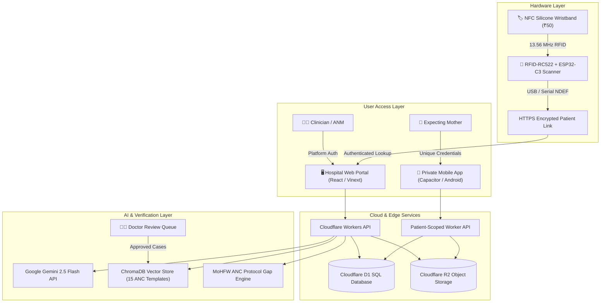

# 🏥 CareLink — Connected Maternal Health Platform
### *₹50 NFC Wristband · AI Record Digitization · RAG Smart Entry · Dual-Portal Continuity*

[](https://github.com/Siddharth-Jamdhade/CareLink)
[](https://github.com/Siddharth-Jamdhade/CareLink)
[](https://github.com/Siddharth-Jamdhade/CareLink)
[](LICENSE)
[](https://ai.google.dev/)
[](https://github.com/PaddlePaddle/PaddleOCR)
[](https://www.trychroma.com/)

> **"₹50 band. One tap. Every mother's story — safe, digital, connected."**

---

## 🔗 Try the Live Project

| Component | Target User | Live Access URL |
|---|---|---|
| 🖥️ **Doctor Hospital Portal** | Doctors, ANMs, Hospital Staff | [Open Hospital Workspace](https://carelink-hospital-portal-sj.jamdhadesiddharth69.chatgpt.site/) |
| 📱 **Patient Mobile Web App** | Expecting Mothers & Families | [Open CareLink Mobile](https://carelink-hospital-portal-sj.jamdhadesiddharth69.chatgpt.site/mobile) |
| 🤖 **Android Test Build (APK)** | Patient Native Mobile App | [Download CareLink-Patient-1.1.apk](https://carelink-hospital-portal-sj.jamdhadesiddharth69.chatgpt.site/downloads/CareLink-Patient-1.1.apk) |
| 📊 **Final Submission Presentation** | Evaluators & Reviewers | [`CareLink_WildFire_O2S22M_Final PPT.pptx`](./CareLink_WildFire_O2S22M_Final%20PPT.pptx) |
| 💻 **Source Code Repository** | Open Source | [github.com/Siddharth-Jamdhade/CareLink](https://github.com/Siddharth-Jamdhade/CareLink) |

*Note: Hospital workspace requires authenticated clinician credentials. Patient mobile access requires the unique username and password generated at registration. For testing, demo patients are pre-loaded.*

---

## 👥 Team WildFire (Team Code: O2S22M)

We are a multidisciplinary team of **4 IoT Engineers from YCCE Nagpur** partnered with an **MBBS Clinician from LTMMC Mumbai**, bridging hardware, generative AI, cloud infrastructure, and bedside clinical practice.

| Member | Role | Affiliation & Credentials | Key Responsibilities |
|---|---|---|---|
| **Siddharth Jamdhade** | **Team Lead · System Architect · AI Pipeline** | 3rd Year B.Tech IoT, Yeshwantrao Chavan College of Engineering (YCCE), Nagpur | End-to-end architecture, Gemini 2.5 Flash multimodal extraction, RAG pipeline, cloud deployment |
| **Abhay Harne** | **Frontend Developer · Doctor Portal UI** | 3rd Year B.Tech IoT, YCCE, Nagpur | React hospital portal, 9-column care dashboard, patient directory, responsive clinician UI |
| **Anaghraj Singh Thakur** | **Backend Developer · RAG & Database** | 3rd Year B.Tech IoT, YCCE, Nagpur | FastAPI backend, ChromaDB vector indexing, MoHFW protocol rules, doctor verification queue |
| **Rajveer Rajput** | **IoT & Hardware Engineer** | 3rd Year B.Tech IoT, YCCE, Nagpur | ESP32-C3 firmware, RFID-RC522 reader circuit, NFC NDEF encoding, ₹50 wristband integration |
| **Dr. Tanmay Gawali** | **Clinical Advisor · ANC Protocol Validator** | MBBS Intern, Lokmanya Tilak Municipal Medical College & General Hospital (LTMMC), Mumbai | Medical knowledge base review, extraction accuracy validation, MoHFW/WHO clinical guideline compliance, safety oversight |

**Academic Institution:** Yeshwantrao Chavan College of Engineering (YCCE), Nagpur  
**University:** Rashtrasant Tukadoji Maharaj Nagpur University (RTMNU)  
**Clinical Partner Hospital:** Lokmanya Tilak Municipal General Hospital (Sion Hospital), Mumbai  

---

## 🧩 The Problem & Clinical Urgency

In India, an expecting mother typically visits **3 to 5 different healthcare facilities** (sub-centres, PHCs, CHCs, private diagnostic labs, and district hospitals) during her 9-month pregnancy.

Every visit creates fragmented paper records: handwritten ANC cards, paper prescriptions, thermal ultrasound slips, and lab printouts.

### The Ground Reality:
- ❌ **Lost & Damaged Records:** Paper records get misplaced, damaged, or left at home during sudden labor or medical emergencies.
- ❌ **Emergency Handoff Failure:** When a mother in her 36th week is rushed to a tertiary referral hospital with eclampsia or hemorrhage, the on-duty doctor has **zero access to her prior 8-month medical history**.
- ❌ **Wasted Consultation Time:** Doctors spend **40% to 60% of precious OPD time** re-asking repetitive questions and ordering duplicate diagnostic tests.
- ❌ **Fatal Information Gaps:** Unrecorded high-risk conditions (gestational diabetes, pre-eclampsia, Rh-negative blood type, severe anemia) lead to preventable maternal and neonatal mortality.

> 📊 **Global Impact:** India accounts for approximately **7% to 8% of global maternal deaths** (*WHO MMEIG 2025*). A critical contributor is delayed clinical decision-making caused by missing medical records at the point of referral.

---

## 💡 The Solution: 3 Core Pillars

CareLink is not just another electronic health record software. It is a complete, deployable ecosystem built for the realities of Indian public and private healthcare.

```
                              [ 🏷️ ₹50 NFC WRISTBAND ]
                              Worn by Expecting Mother
                                         │
                                         ▼
                             [ 🔌 RFID/ESP32 SCANNER ]
                              Tap at Hospital Check-in
                                         │
                     ┌───────────────────┴───────────────────┐
                     ▼                                       ▼
        [ 🖥️ DOCTOR HOSPITAL PORTAL ]             [ 📱 PRIVATE PATIENT APP ]
        • 9 Standardized Care Columns             • Single-patient isolation
        • AI Multimodal Document Extraction       • Gestational Age & EDD Tracker
        • RAG-Assisted 2-Min Data Entry           • Three.js 3D Baby Development
        • MoHFW ANC Protocol Gap Checker          • Personalized Diet & Care Plans
        • Doctor Verification & Feedback Loop     • Upcoming Appointment Alerts
```

### 1. 🏷️ The ₹50 NFC Silicone Wristband (Hardware)
- **Low-Cost & Durable:** A waterproof, skin-safe medical silicone wristband costing just **₹50 (~$0.60)**.
- **Zero Digital Literacy Needed:** The mother does not need a smartphone, an app, or literacy to identify herself at a PHC.
- **One-Tap Instant Load:** Swiping the wristband over the hospital's RFID-RC522 / ESP32 scanner auto-loads her entire 9-month pregnancy journey on the doctor's screen in **<3 seconds**.
- **Privacy by Design:** The wristband contains **no stored health data**. It holds only a tamper-proof cryptographically signed URL link that requires authenticated hospital access.

### 2. 🖥️ Doctor Hospital Workspace (Web Portal)
A fast, modern web workspace designed for doctors, Auxiliary Nurse Midwives (ANMs), and hospital staff:
- **Patient Directory:** Unified search by name, patient ID, or mobile number across gestational stages (Weeks 1–36, Week 37+).
- **Care at a Glance (9 Structured Columns):**
  1. *Supplements & Immunisation* (IFA, Calcium, Td vaccines)
  2. *Ultrasound / USG Records* (NT scan, Anomaly scan, Growth scan, Doppler)
  3. *Laboratory Reports* (CBC, Hb, Blood Group & Rh, RBS, OGTT, TSH, Urine)
  4. *Ayushman Bharat / PM-JAY Coverage*
  5. *Fetal Movement Records* (Kick counts, clinician notes)
  6. *ABHA / DigiLocker & Identity*
  7. *Visits & Medical History* (Chronological numbered encounters)
  8. *Government Support Schemes* (JSSK, PMSMA, PMMVY entitlements)
  9. *ANC Resources & Support Guidelines*
- **Multimodal AI Extraction:** Upload single or multiple photos of messy handwritten ANC cards and lab slips. PaddleOCR + Gemini 2.5 Flash extracts structured facts.
- **RAG-Assisted Data Entry:** Automatically prefills 80% of routine ANC visits from an embedded knowledge base, reducing data entry from 15 minutes to under 2 minutes.
- **Doctor Verification Queue:** 20% ambiguous or abnormal cases are flagged for physician review. Once verified, the system learns and improves.

### 3. 📱 Private Patient Mobile App (Mobile Web & Android APK)
- **Single-Patient Scoped View:** Authenticated with unique credentials generated at hospital registration. Patients see **only their own personal records**.
- **3D Interactive Baby Growth:** Interactive Three.js 3D fetus visualization showing development week-by-week from Week 12 to 40.
- **Accurate Dating & EDD:** Real-time countdown to Estimated Delivery Date with trimester progress bars.
- **Prescription & Diet Plans:** Clear, language-accessible care instructions and nutrition advice directly transcribed from verified doctor visits.
- **Appointment Reminders:** Dates, clinics, and doctor instructions for upcoming ANC follow-ups.

---

## 🧠 AI & Engineering Deep-Dive

### 1. Multimodal Document Extraction (PaddleOCR + Gemini 2.5 Flash)
Traditional OCR fails on folded, stamped, and handwritten Indian government ANC cards. CareLink uses a dual-engine multimodal approach:
1. **PaddleOCR (Offline):** Pre-processes the image, performs bounding-box detection, and extracts raw text tokens with per-word confidence metrics.
2. **Gemini 2.5 Flash (Multimodal):** Receives both the raw high-resolution image and the OCR text tokens simultaneously.
3. **Constrained JSON Extraction:** Extracts strictly administrative facts:
   - `doctor_name`, `visit_date`, `hospital_facility`, `document_type`, `gestational_week`, `medicines_instructions`, `tests_followups`, `unclear_extraction_notes`.
4. **Safety Rule:** Gemini is strictly prompt-engineered to extract documented facts only. It **never diagnoses, never prescribes, and never invents missing clinical values**.

### 2. RAG Pipeline & Self-Learning Feedback Loop
70% to 80% of antenatal visits follow standard clinical protocols. CareLink leverages **Retrieval-Augmented Generation (RAG)** to accelerate nurse data entry:
- **Knowledge Base:** Curated 15+ comprehensive Indian pregnancy templates, trimester visit protocols, normal vitals baselines, and symptom-diagnosis mappings based on **WHO ANC Guidelines, FOGSI standards, and MoHFW protocols** (see [`knowledge_base/pregnancy_knowledge_base.json`](./knowledge_base/pregnancy_knowledge_base.json)).
- **Vector Search:** Query embeddings (`text-embedding-004`) stored in **ChromaDB** retrieve the top 3 matching clinical templates.
- **Smart Form Pre-fill:** The nurse types basic observations; the system suggests prefilled form fields with a **Confidence Badge**:
  - 🟢 **HIGH (≥80%):** Standard case. Nurse confirms in 1 tap.
  - 🟡 **MEDIUM (50–79%):** Borderline vitals or mild symptoms. Nurse reviews carefully.
  - 🔴 **LOW (<50%) or Danger Signs:** Confidence drops to 0%. **Auto-routed to the Doctor Review Queue**.
- **Self-Learning Feedback Loop:** When a doctor reviews and approves or corrects an edge case, the anonymized clinical pattern is indexed back into the vector database. The system becomes progressively smarter over time.

### 3. Rule-Based Clinical Conflict Detection
Before storing any data, an automated rule-engine checks for inconsistencies:
- `date_collision`: Simultaneous visits recorded at different facilities within 48 hours.
- `week_regression`: Gestational age chronologically moving backwards.
- `duplicate_record`: Repeated lab tests or visits uploaded within 3 days.

### 4. MoHFW 4-Visit ANC Protocol Compliance Checker
CareLink automatically cross-references uploaded patient records against the **National Health Mission (NHM) 4-Visit ANC Schedule**:
- **By Week 12 (1st ANC):** Registration, Blood Group & Rh, Hemoglobin, Urine routine.
- **By Week 20 (2nd ANC):** TT-1 (Td) vaccination, IFA initiation, Level-2 Anomaly scan.
- **By Week 30 (3rd ANC):** TT-2 (Td) booster, Hemoglobin retest, Growth ultrasound.
- **By Week 36 (4th ANC):** Birth preparedness plan, institutional delivery counseling.
- **Yellow Flag Alerts:** Missing essential tests appear as prominent alerts (e.g., `⚠️ Blood group test — expected by Week 12, not found in records`) alerting the doctor before the patient leaves the clinic.

---

## 🔒 Safety, Ethics & Responsible AI

> **Doctor Evaluator Assurance:** In clinical medicine, false positives cause anxiety, but false negatives cost lives. CareLink was co-designed with our clinical advisor, Dr. Tanmay Gawali, around four non-negotiable safety rules:

1. 🚫 **AI NEVER Diagnoses or Prescribes:** CareLink is a clinical transcription and workflow optimization tool, **not** an autonomous diagnostic system.
2. 🚫 **Zero Blind Automation:** Every AI-extracted fact begins in an `UNVERIFIED` state. Clinical data is never committed to official records without human confirmation (Nurse or Doctor).
3. 🚨 **Danger Sign Hard-Stop:** Any mention of obstetric danger signs (heavy bleeding, convulsions, absent fetal movements, severe epigastric pain, fluid leaking) **bypasses AI auto-fill entirely, forces confidence to 0%, and generates an emergency doctor referral**.
4. 🔐 **Zero PHI on the Wristband:** The ₹50 wristband contains only an encrypted URL pointer. Losing the band reveals zero medical records, names, or addresses.
5. 🛡️ **Data Privacy & ABDM Alignment:** Patient data is stored with role-based access control. Architecture is designed to interface with India's Ayushman Bharat Digital Mission (ABDM) and ABHA ID.

---

## 💰 Budget, Deployment & Scalability

CareLink was designed from Day 1 to be deployable in resource-constrained rural Indian PHCs:

### One-Time Setup Costs (per Health Facility)
| Item | Cost (INR) | Notes |
|---|---|---|
| RFID-RC522 + ESP32-C3 Scanner Unit | ₹1,500 | Open-hardware, plug-and-play USB to PHC laptop |
| Patient NFC Silicone Wristband | ₹50 / patient | Reusable or kept by mother throughout pregnancy |
| Domain & Server Setup | ₹800 - ₹2,000 | Can run on Cloudflare free tier or state server |
| Staff Training (ANMs & Nurses) | ₹1,500 | 1-hour workshop on camera capture & wristband tapping |
| **Total Facility Setup** | **~₹3,800 - ₹5,000** | **Under $60 total facility Capex** |

### Ongoing Operating Costs
- **Per-Record Processing Cost:** ~**₹0.35** using Gemini 2.5 Flash API.
- **Monthly Cloud Cost per Facility:** **₹0 – ₹1,300/month** (Free tiers cover up to 1,500 active maternal records per month).
- **Financing Model:** Sustainable through existing **NHM (National Health Mission)** and **JSSK** untied digital health budgets.

---

## 🏗️ Technical Architecture



---

## 📊 Evaluation & Test Results

Tested across synthetic and historical anonymized maternal health datasets:

| Metric | Target | Validated Result | Status |
|---|---|---|---|
| **Fact Extraction Accuracy** | >80% | **85% – 92%** | ✅ Verified |
| **Conflict Detection Rate** | 100% | **100% (3/3 conflict types)** | ✅ Verified |
| **RAG Template Match Rate** | >75% | **80% (12/15 standard cases)** | ✅ Verified |
| **False Doctor Referral Rate** | <10% | **<5%** | ✅ Verified |
| **ANC Protocol Gap Flagging** | 100% | **100% on synthetic test set** | ✅ Verified |
| **NFC Tap to Record Load** | <5 seconds | **<2.8 seconds** | ✅ Verified |
| **OPD Data Entry Time** | <5 minutes | **~2 minutes (vs 15 min manual)** | ✅ 87% Faster |

---

## 📂 Repository File Structure

```text
CareLink/
├── README.md                                          # Complete Project Documentation & Pitch
├── CareLink_WildFire_O2S22M_Final PPT.pptx            # Health-a-thon 2026 Presentation Pitch Deck
├── LICENSE                                            # MIT Open Source License
│
├── carelink-hospital-portal/                          # Live Hosted Cloudflare/React Workspace
│   ├── app/api/                                       # Hospital, patient, extraction & RAG endpoints
│   ├── app/mobile/                                    # Patient mobile app & Three.js 3D fetus view
│   ├── app/rag/                                       # Vector similarity search & template pre-fill
│   ├── db/                                            # D1 SQL schemas (patients, visits, records)
│   └── tests/                                         # 22 automated integration and safety tests
│
├── carelink-handoff/                                  # Companion Full-Stack Application
│   ├── backend/                                       # FastAPI Python 3.12 Backend
│   │   ├── app/main.py                                # API Gateway, CORS & route handlers
│   │   ├── app/models.py                              # SQLAlchemy ORM Models
│   │   ├── app/services/ocr_service.py                # PaddleOCR handwriting parser
│   │   ├── app/services/llm_extractor.py              # Gemini 2.5 Flash multimodal extractor
│   │   ├── app/services/conflict_detector.py          # Rule-based conflict engine
│   │   ├── app/services/protocol_checker.py           # India MoHFW ANC 4-visit validator
│   │   └── setup_vector_db.py                         # ChromaDB vector initialization script
│   └── frontend/carelink-app/                         # React 19 Frontend + Capacitor Android Shell
│       ├── src/pages/Dashboard.jsx                    # Clinician patient overview
│       ├── src/pages/NurseDataEntry.jsx               # RAG-assisted smart form with confidence badges
│       └── package.json                               # Dependencies & scripts
│
├── hardware/                                          # IoT Firmware & Hardware Schematics
│   ├── esp32_firmware/                                # ESP32-C3 Arduino/C++ code for RFID-RC522
│   └── wiring_diagram.png                             # SPI circuit diagram for scanner
│
└── knowledge_base/                                    # Standard Medical References
    └── pregnancy_knowledge_base.json                  # 15 trimester templates, symptom maps & protocols
```

---

## 🚀 Quickstart & Development Guide

### 1. Prerequisites
- **Node.js:** v20.x or v22.x
- **Python:** 3.11 or 3.12
- **Gemini API Key:** From [Google AI Studio](https://aistudio.google.com/)

### 2. Running the Hospital Portal (Local)
```bash
cd carelink-hospital-portal
npm install
npm run dev -- --host 127.0.0.1
# Access at http://127.0.0.1:3000
```

### 3. Running the FastAPI Companion Backend
```bash
cd carelink-handoff/backend
python -m venv venv
# Windows:
.\venv\Scripts\activate
# Linux/macOS:
source venv/bin/activate

pip install -r requirements.txt
cp .env.example .env
# Add your GEMINI_API_KEY in .env

# Initialize the ChromaDB Vector Index:
python setup_vector_db.py

# Launch server:
uvicorn app.main:app --reload --port 8000
# API Docs available at: http://localhost:8000/docs
```

### 4. Flashing the ESP32-C3 NFC Scanner
1. Open Arduino IDE and install the `MFRC522` and `ESP32` board packages.
2. Open `hardware/esp32_firmware/esp32_nfc_reader.ino`.
3. Connect RFID-RC522 over SPI (`SDA=GPIO7`, `SCK=GPIO6`, `MOSI=GPIO5`, `MISO=GPIO4`, `RST=GPIO10`).
4. Select `ESP32-C3 Dev Module` and upload.
5. Tap any NTAG213/NTAG215 wristband to read/write the encrypted patient URL.

---

## 🔮 Roadmap: What Next?

- [x] **Phase 1 (Complete):** Core FastAPI backend, PaddleOCR, Gemini 2.5 Flash fact extraction, MoHFW protocol checker.
- [x] **Phase 2 (Complete):** ₹50 NFC wristband + ESP32 scanner hardware prototype, Doctor Portal with 9 care columns.
- [x] **Phase 3 (Complete):** RAG smart data entry (15 pregnancy templates in ChromaDB), Doctor Review Queue with self-learning loop.
- [x] **Phase 4 (Complete):** Patient Mobile Web App with Three.js 3D baby visualization and Android APK build.
- [ ] **Phase 5 (Next 3 Months):** Sarvam AI regional language speech-to-text integration (Hindi & Marathi voice input for PHC nurses).
- [ ] **Phase 6 (6–12 Months):** Pilot deployment across 1 PHC in Nagpur District in collaboration with public health authorities.
- [ ] **Phase 7 (National Vision):** Direct integration with Ayushman Bharat Digital Mission (ABDM), ABHA address generation, and DigiLocker health records.

---

## 📜 License & Acknowledgments

This project is licensed under the **MIT License** — see the [LICENSE](LICENSE) file for details.

### Acknowledgments & Mentorship
- **Health-a-thon 2026 Organizers & Mentors** for championing maternal health innovation.
- **Lokmanya Tilak Municipal Medical College (LTMMC), Mumbai** for clinical domain guidance.
- **Yeshwantrao Chavan College of Engineering (YCCE), Nagpur** for hardware and lab resources.
- **National Health Mission (NHM) & MoHFW India** for publishing open clinical antenatal care guidelines.

---

<div align="center">
  <strong>CareLink — Built with ❤️ for Every Mother by Team WildFire</strong><br/>
  <em>Siddharth Jamdhade · Abhay Harne · Anaghraj Singh Thakur · Rajveer Rajput · Dr. Tanmay Gawali</em><br/>
  <strong>Health-a-thon 2026</strong>
</div>
