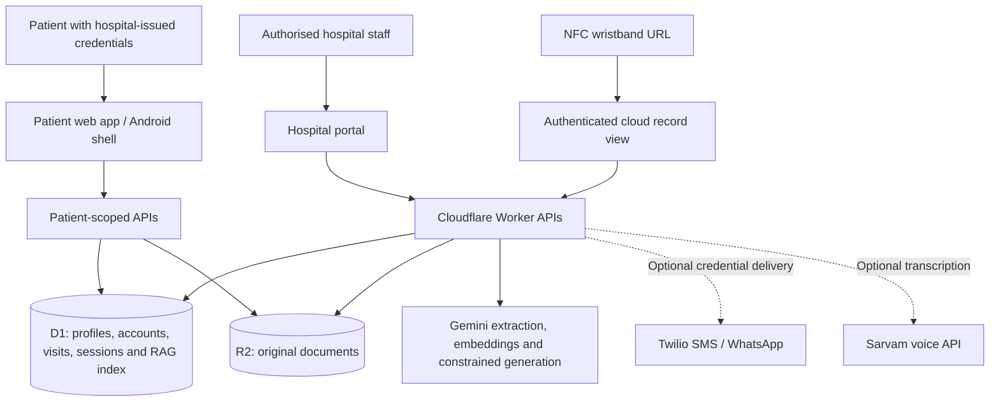

# CareLink — Connected Maternal Care

CareLink is a Health A Thon project that connects a hospital workspace with a private patient app. It brings registration details, uploaded medical documents, visit history and recorded care instructions into one maternal-care journey.

Hospital staff manage patient records and review AI-extracted information. Patients sign in with hospital-issued credentials to see only their own information.

## Try the project

| Application | Link |
| --- | --- |
| Hospital portal | [Open hospital workspace](https://carelink-hospital-portal-sj.jamdhadesiddharth69.chatgpt.site/) |
| Patient mobile web app | [Open CareLink Mobile](https://carelink-hospital-portal-sj.jamdhadesiddharth69.chatgpt.site/mobile) |
| Android 1.1 test build | [Download APK](https://carelink-hospital-portal-sj.jamdhadesiddharth69.chatgpt.site/downloads/CareLink-Patient-1.1.apk) |

Hospital access requires an authorised staff account. Patient access requires the username and password issued during registration. The Android APK is a debug-signed test build; older installed versions that point to the previous Render server need this update.

## The problem

Maternal-care records can be spread across ANC cards, prescriptions, laboratory reports, ultrasound reports and different healthcare facilities. When a patient changes providers, reconstructing earlier visits can be difficult.

CareLink preserves original documents, organises their contents into linked visits, and keeps the patient's view connected to the hospital's cloud record. AI helps with transcription and data entry; healthcare professionals remain responsible for reviewing information and making care decisions.

## Hospital workspace

- **Patient registration:** name, age, weight, address, photograph, blood group, registration date, gestational age and mobile number. A unique username and password are generated for the patient's account.
- **Patient directory:** search and open individual patient dashboards with pregnancy details, EDD, GPL score and care contacts.
- **Multiple document uploads:** upload several images or PDFs together, with individual progress, extraction status and retry handling. Supported formats are PDF, JPEG, PNG and WebP, up to 10 MB per file.
- **AI extraction:** transcribe documented details into profile, supplements, immunisation, ultrasound, laboratory, coverage, identity and history sections. Missing or unreadable details remain explicit.
- **Connected history:** numbered visits link dates, providers, facilities, notes, extracted fields and original documents. A source containing several visits can contribute to separate encounters.
- **Human review:** source quotes, page references, original values, corrections and review statuses remain available for checking extracted information.
- **Consultation entry:** record findings, patient-facing care instructions, an individual diet plan and the next appointment's date, time and clinic.
- **Recoverable portal removal:** hide patients, visits, documents or notes from the active portal and restore them from the archive.
- **Readable interface:** responsive white backgrounds, light cards and a shared typography scale with a 16px base and rem-based text sizes.

## Private patient app

The patient app uses the same cloud account created by the hospital. Its server fixes each session to one patient; it does not provide a hospital-wide directory or a patient selector.

| Section | Patient experience |
| --- | --- |
| Home | Personal pregnancy summary, estimated delivery date, gestational age, progress and recorded upcoming appointment |
| My baby | Interactive Three.js fetal-stage illustration for weeks 12–40, with rotation, zoom and clearly labelled week previews |
| Appointments | Recorded appointment dates, times, clinics and providers, plus previous visits |
| Medical history | Linked visit history, consultation notes, original documents, laboratory and ultrasound information |
| My plan | Recorded care instructions, supplements, immunisation and individual diet instructions when available; general food education is labelled separately |
| Profile | Personal details, pregnancy dating, support contacts, password change and sign-out |

Pregnancy dating uses the hospital-recorded EDD when available. Otherwise, gestational age at registration provides a dated reference for an explicitly labelled estimate. If valid dating is unavailable, the app does not invent a current pregnancy stage.

The 3D illustration is educational and is not an ultrasound or a measurement of the patient's baby. Appointments are displayed from records; the app does not make bookings. Individual care plans and diets come from recorded instructions rather than automatic treatment generation.

## Cloud records and wristband access

The deployed hospital portal and patient app share **Cloudflare D1** for structured records and accounts, and **Cloudflare R2** for original documents.

A patient's wristband link can be written as an HTTPS NDEF URL to a compatible NFC band. Scanning opens the linked record subject to authentication and access checks. Possession of a link alone does not grant access to medical information.

**Removing data from the portal changes its visibility; it does not permanently erase the cloud record.** The retained cloud/NFC view includes hidden history, and the authenticated patient can continue to see their retained records. Shared source documents remain linked to other visits when one visit is hidden.

Browser NFC writing and camera-based scanning are not implemented. Use a compatible NFC writer to encode the generated wristband link.

## RAG-assisted clinical data entry

The hospital's **Prepare entry** workflow uses retrieval-augmented generation to help staff structure a consultation entry:

1. Build a query from entered pregnancy stage, reported concerns and recorded observations.
2. Embed the query and retrieve the top three matching knowledge-base sources.
3. Prepare a form using the retrieved source's permitted field structure and the staff member's actual inputs.
4. Let staff review and edit the entry, then confirm it or send it to the doctor-review queue.
5. Route flagged or low-similarity cases for review. Reported warning signs trigger review routing without waiting for AI generation.
6. Index approved feedback as reusable form structure, excluding patient observations and identifying information from the shared feedback index.

The current seed knowledge base contains **38 source documents**. The companion Python implementation uses persistent **ChromaDB**. The hosted Worker uses the same seed embeddings in **D1** and exact cosine retrieval over the small index; it does not require a laptop-local Python server.

Retrieval similarity measures a search match, **not clinical confidence, diagnostic accuracy or patient risk**. The supplied knowledge base is a draft reference. Templates do not establish normal findings, diagnoses, prescriptions or appointment dates for a patient. Doctor approval is checked on the server.

## Architecture



The existing **React + FastAPI** application is a companion implementation with SQLAlchemy, SQLite or configured database storage, OCR/extraction services, assignment-based access and a Chroma-backed RAG workflow. It is separate from the deployed Sites cloud service; newer local companion changes require their own deployment before they appear on the legacy Render service.

## Technology

| Layer | Technologies |
| --- | --- |
| Hosted portal and patient UI | React, TypeScript/JavaScript, Vinext, CSS, Lucide |
| Hosted APIs and storage | Cloudflare Workers, D1, R2, Drizzle migrations, Zod validation |
| Patient 3D experience | Three.js and OrbitControls |
| Android application | Capacitor, Android SDK, Gradle |
| AI services | Google Gemini multimodal extraction, embeddings and source-constrained generation |
| Companion backend | Python, FastAPI, SQLAlchemy, Uvicorn, ChromaDB; PaddleOCR in the companion OCR pipeline |
| Companion frontend | React, React Router, Axios |
| Optional integrations | Twilio credential messaging and Sarvam transcription |

## Source organisation

```text
Health A thon/
├── README.md
├── carelink-hospital-portal/           # Separately versioned Sites source checkout
│   ├── app/api/                       # Hospital, patient, extraction and RAG APIs
│   ├── app/mobile/                    # Patient app and 3D illustration
│   ├── app/rag/                       # Retrieval, review and entry workflow
│   ├── db/                            # D1 schema
│   ├── drizzle/                       # Database migrations
│   └── tests/                         # Patient, records, retention and RAG checks
├── carelink-handoff/                  # Companion application
│   ├── backend/                       # FastAPI, OCR/extraction and Chroma RAG
│   └── frontend/carelink-app/          # React frontend and Capacitor Android project
├── knowledge_base/                    # Draft pregnancy knowledge-base sources
├── RAG_IMPLEMENTATION.md              # Detailed RAG implementation notes
└── MOBILE_PATIENT_LINK.md             # Linked mobile app and Android build notes
```

This tree describes the development workspace. Hosted Sites source is versioned independently; a checkout of this GitHub repository alone may not contain the latest Sites checkout or unpublished companion changes. Use the live links above to review the published experience.

## Development

### Hosted Sites source

With the separately versioned `carelink-hospital-portal` source checkout available, use Node.js 22.13 or later:

```bash
cd carelink-hospital-portal
npm ci
npm run dev -- --host 127.0.0.1
```

Apply the checked-in D1 migrations to local storage before testing database-backed features. Local development uses a mock hospital sign-in; production uses platform authentication and server-side staff allowlists. Keep development credentials in ignored local configuration. Hosted publication applies the checked-in migrations.

### Companion FastAPI and React application

Use Python 3.12 and an environment with the project's dependencies. In PowerShell:

```powershell
Set-Location carelink-handoff/backend
python -m venv venv
./venv/Scripts/Activate.ps1
pip install -r requirements.txt
Copy-Item .env.example .env
# Set GEMINI_API_KEY and the required local settings in .env.
uvicorn app.main:app --reload --port 8000
```

In a second terminal:

```powershell
Set-Location carelink-handoff/frontend/carelink-app
npm ci
npm start
```

The companion frontend runs at `http://localhost:3000`; backend API documentation is at `http://localhost:8000/docs`. For local HTTP authentication, use the development-only `CARELINK_COOKIE_SECURE=0` setting. Keep secure cookies enabled for HTTPS deployments.

In a companion checkout containing the new RAG modules, run `python setup_vector_db.py` in the backend directory with server-side Gemini credentials configured to initialise its Chroma index.

### Runtime configuration

| Service | Server-side settings |
| --- | --- |
| Gemini | `GEMINI_API_KEY`, `GEMINI_MODEL`; RAG uses its configured embedding/generation model settings |
| Hospital access | `CARELINK_STAFF_EMAILS`, `CARELINK_DOCTOR_EMAILS` on the hosted service |
| Twilio | `TWILIO_ACCOUNT_SID`, `TWILIO_AUTH_TOKEN`, `TWILIO_FROM`, optional `TWILIO_CHANNEL` on the hosted service |
| Sarvam | `SARVAM_API_KEY`, optional `SARVAM_MODEL` |
| Companion storage | `CARELINK_DATABASE_URL`, `CARELINK_UPLOAD_DIR`, optional persistent Chroma path |

Secrets belong in runtime settings or ignored environment files, never in browser bundles or Git. Hosted and companion services have separate configuration and deployment environments.

## Validation

The latest patient/cloud update passed:

- TypeScript checking and the hosted production build.
- **22 automated checks** across patient projection and dating, visit grouping, source review, cloud retention and RAG policy.
- Local HTTP integration using two fictional patients: issued credentials, account/file isolation, hospital and RAG denial for patient sessions, CSRF rejection, retained history, logout, password change and login throttling.
- Browser checks for login/reload, EDD/progress, 3D rendering, appointments, history, plans, profile and sign-out, including a 390px-wide viewport.
- Android APK build, signature verification and package/version inspection.

The Android test build has not been tested on a physical device. These checks are software verification, not evidence of clinical effectiveness or full accessibility certification.

## Integration status and next steps

| Capability | Current status |
| --- | --- |
| Hospital registration, cloud records, multiple uploads and patient-scoped login | Implemented and published |
| Source-linked AI extraction and numbered visit history | Implemented; extracted content requires review |
| RAG entry and doctor-review queue | Implemented; reference content needs clinical validation |
| Patient EDD, progress, stage illustration and recorded care/appointment views | Implemented and published |
| NFC wristband links | Implemented; band writing requires an external compatible writer |
| SMS / WhatsApp credential delivery | Implemented integration; Twilio is not connected in the current deployment |
| Hindi, Marathi and English voice transcription | Implemented integration; disabled until Sarvam is configured |
| DigiLocker, identity verification and scheme eligibility | Not connected |
| ESP32 direct vitals capture | Future work |
| Automated personalised treatment or diagnosis | Not provided |

Before clinical rollout, validate reference content and workflows with clinicians, complete physical-device and accessibility testing, and establish the deployment's operational and data-governance requirements.

## Privacy and record integrity

Hospital APIs require an allowlisted platform-authenticated staff identity. Patient APIs use separate, expiring sessions bound to a single patient, with ownership checks for original files. Passwords are salted and hashed; the app does not store patient records or passwords in localStorage. Login throttling, origin checks and logout/session revocation protect the patient account flow.

Original source documents and correction history remain available. Unreadable or undocumented details are not filled in as facts. Portal removal preserves the cloud archive and is not a permanent deletion mechanism.

## License

[MIT](LICENSE).
